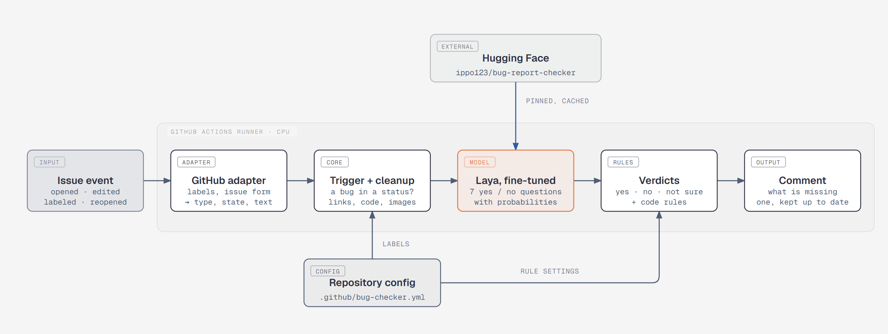

# bug-report-checker

[](https://github.com/maksimTrs/bug-report-checker/actions/workflows/ci.yml)

GitHub Action that checks whether a bug report is complete — steps to reproduce, expected and actual result, build version — and comments with what is missing.

Decisions are made by a fine-tuned [Laya](https://github.com/NandhaKishorM/laya) model on a free CPU runner: [ippo123/bug-report-checker](https://huggingface.co/ippo123/bug-report-checker). No LLM API and no keys: the only network calls are the GitHub API and the model download.

See it at work: [bug-report-checker-sandbox](https://github.com/maksimTrs/bug-report-checker-sandbox) — demo issues and end-to-end tests.



## How it works

1. **Adapter** (`github.py`) turns an issue into a tracker-neutral `Issue`: type from the `bug` label or the native issue type, status from labels, text from the body or the issue form.
2. **Trigger** (`core.py`): only bugs in a listed status are checked; anything else ends silently.
3. **Cleanup** (`preprocess.py`): links become hosts, images `[image]`, code and stack traces are cut to a few lines — the same rules as in training.
4. **Model** (`decide.py`): seven yes / no questions with probabilities. Below the confidence threshold an answer is "not sure", never a verdict.
5. **Rules** (`rules.py`): what code decides better than a model — the team's build format, empty template sections, screenshot-only results, and strict mode.
6. **Comment** (`comment.py`, `publish.py`): blockers under *Missing*, hints under *Suggestions*. The bot edits its own comment instead of posting a new one and skips the model when nothing it depends on changed.

Cold start is about 1.5 minutes (model download), later runs 30–45 s; the model and the check take ~13 s.

## Usage

Copy [`docs/example-workflow.yml`](docs/example-workflow.yml) to `.github/workflows/bug-checker.yml`. The core of it:

```yaml
on:
  issues:
    types: [opened, edited, labeled, unlabeled, typed, untyped, reopened]
permissions:
  contents: read
  issues: write
jobs:
  check:
    runs-on: ubuntu-latest
    steps:
      - uses: maksimTrs/bug-report-checker@v1
```

The full example also warms the model cache on `push` / `schedule`: runs triggered by `issues` get a read-only Actions cache.

## Configuration

Optional `.github/bug-checker.yml` on the default branch; every key has a default, an invalid file fails with the key's name.

| Key | Default | Meaning |
|---|---|---|
| `bug_labels` | `[bug]` | Labels that mark a bug (the native `Bug` issue type counts too) |
| `status_labels` | `[Submitted, Open, In Progress]` | Statuses to check in; an open bug without one is `Submitted` |
| `threshold` | `0.827` | Confidence below which an answer is "not sure" (0.5–0.85) |
| `comment_on_success` | `true` | Comment on a complete report too |
| `build_version_pattern` | none | Regex of your build format; without it the model decides |
| `environments` | `[]` | Test stand names to recognise, besides `prod` |
| `strict` | `false` | Steps, expected and actual must be stated in the description |

**Strict mode.** By default the model follows a lenient rubric: an expected or actual result may follow from the title ("Export fails" implies "export should work"). With `strict: true`, rules on top can only turn "present" into "missing": at least two steps or a reproducing command, an expected result in words, an actual result that is concrete rather than "doesn't work". A clear title with one vague line is no longer complete. The cost is more false "missing", mostly steps written as prose.

## Results

What the bot says at its default threshold, on public Jira reports kept out of training and model selection. *Caught*: reports without the part that the bot calls "missing". *False alarm*: reports with the part that it calls "missing" anyway. The rest of the answers are "not sure".

| Check | Default: caught | Default: false alarm | Strict: caught | Strict: false alarm |
|---|---|---|---|---|
| steps | 50/53 (94%) | 12/47 (26%) | 54/55 (98%) | 14/38 (37%) |
| build version | 70/82 (85%) | 4/18 (22%) | same as default | same as default |
| expected | 5/12 (42%) | 2/88 (2%) | 67/70 (96%) | 1/23 (4%) |
| actual | 4/10 (40%) | 1/90 (1%) | 15/30 (50%) | 5/63 (8%) |

- **Default** is scored on 100 random reports against lenient labels, **strict** on 93 bug reports against strict labels. Different sets, so compare within a mode, not across.
- **Steps and build version carry the bot.** In default mode expected and actual are weak: the model accepts a result implied by the title. Strict mode fixes expected; actual stays at half, since "concrete" is hard to pin down with rules.
- **The sets are small.** The 95% interval of 50/53 is 85–98%, of 5/12 it is 19–68%: read the rows with few cases as a direction, not a figure. Labels come from Claude models against a [public rubric](labeling/rubric.md), not from human annotators.

Details, intervals and the training runs: [docs/results.md](docs/results.md). Labels: [docs/labeling-agreement.md](docs/labeling-agreement.md). Model: [docs/model-card.md](docs/model-card.md).

Limits: English reports, a fixed rubric, training data from public Jira projects.

## Development

```bash
uv sync
uv run pytest
uv run ruff check && uv run ruff format --check
```

CI runs lint and tests on every pull request, plus an eval gate: the bot on 40 held-out reports must not get worse than the baseline.

## Data attribution

Trained on a public dataset and synthetic examples.

Data: The Public Jira Dataset — Montgomery L., Lüders C., Maalej W. *An Alternative Issue Tracking Dataset of Public Jira Repositories.* MSR 2022. DOI: [10.1145/3524842.3528486](https://doi.org/10.1145/3524842.3528486). Dataset: https://doi.org/10.5281/zenodo.5882881. License: [CC BY 4.0](https://creativecommons.org/licenses/by/4.0/).

`eval/eval.jsonl`, `eval/eval_v2.jsonl`, `eval/strict_gold.jsonl` (its `public` records) and `labeling/gold_20.jsonl` contain bug reports from this dataset, changed: preprocessed (links reduced to hosts, images to `[image]`, code cut to a few lines) and e-mail addresses redacted. The completeness labels are ours.
